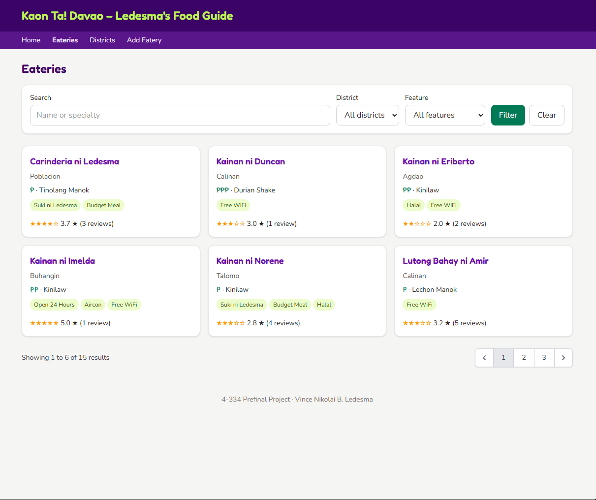
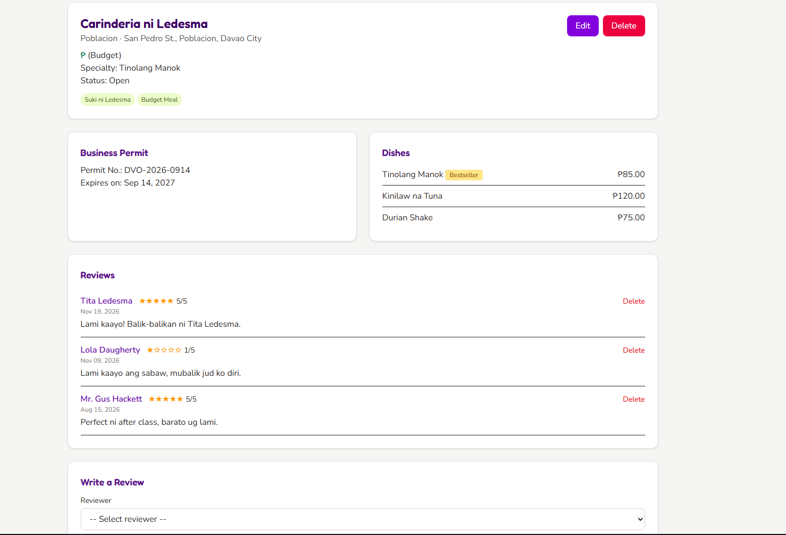
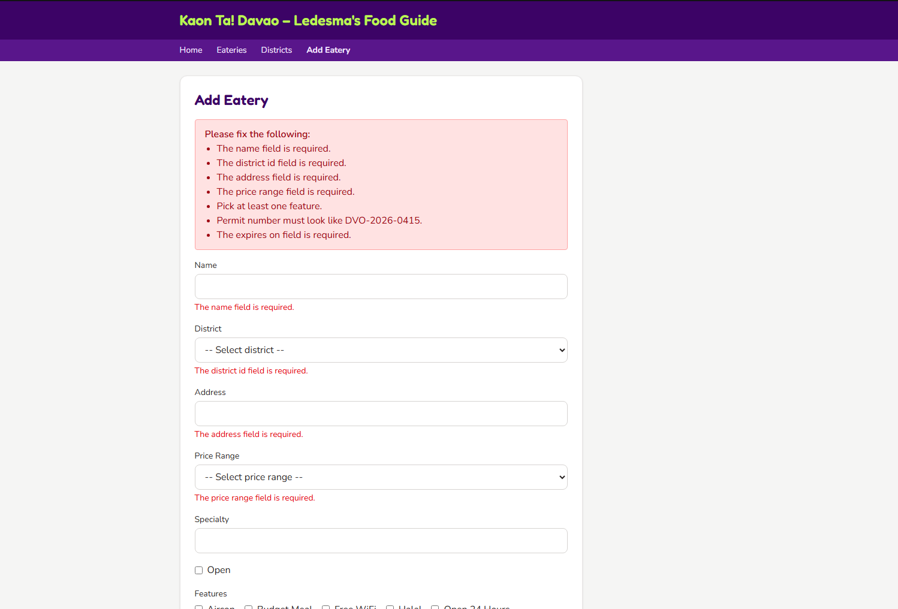

# Kaon Ta! Davao – Ledesma's Food Guide

Prefinal Milestone Project for 4-334 CS Elective 2 Full-Stack Development (Laravel)

By: Vince Nikolai B. Ledesma

Kaon Ta! Davao is a simple guide for carinderias and eateries around Davao City. You can browse eateries by district, check each one's business permit, dishes, and features (Halal, Budget Meal, etc.), and leave reviews. Built with Laravel 12, SQLite, Blade, and Tailwind.

## How to run

```bash
composer install
cp .env.example .env
php artisan key:generate
touch database/database.sqlite
php artisan migrate:fresh --seed
npm install
npm run build        # or npm run dev while developing
php artisan serve
```

Then go to http://127.0.0.1:8000

## Personalized data

Districts: Poblacion, Talomo, Agdao, Buhangin, Toril, Calinan

Features: Suki ni Ledesma, Budget Meal, Halal, Open 24 Hours, Aircon, Free WiFi

Users (password for both is `kaonta2026`):

- Vince Nikolai Ledesma – ledesma@kaonta.test
- Tita Ledesma – tita.ledesma@kaonta.test

My eatery:

- Name: Carinderia ni Ledesma
- Slug: carinderia-ni-ledesma
- District: Poblacion
- Address: San Pedro St., Poblacion, Davao City
- Price range: budget
- Specialty: Tinolang Manok
- Features: Suki ni Ledesma, Budget Meal
- Permit number: DVO-2026-0914 (expires September 14, 2027)
- Dishes: Tinolang Manok ₱85.00 (bestseller), Kinilaw na Tuna ₱120.00, Durian Shake ₱75.00

## Relationships

| Relationship | Type | Why |
|---|---|---|
| District → Eatery | hasMany / belongsTo | One district has a lot of eateries, but an eatery can only be in one district. |
| Eatery → Dish | hasMany / belongsTo | An eatery sells many dishes, and each dish is from just one eatery. |
| Eatery → Review | hasMany / belongsTo | People can post many reviews for one eatery, but each review is only for that one eatery. |
| User → Review | hasMany / belongsTo | One user can write many reviews, and every review has one user who wrote it. |
| Eatery → Permit | hasOne / belongsTo | Each eatery only has one business permit, that's why eatery_id is unique in the permits table. |
| Eatery ↔ Feature | belongsToMany / belongsToMany | An eatery can have many features and one feature can be in many eateries, so I used the eatery_feature pivot table. |
| District → Review (through Eatery) | hasManyThrough | Reviews don't have a district_id, so to count a district's reviews it goes through the eateries first. |

## Route list

`php artisan route:list --except-vendor`

```
  GET|HEAD        / ........................................................................................................................................................................................................................................................................... home › HomeController
  GET|HEAD        districts .............................................................................................................................................................................................................................................. districts.index › DistrictController@index
  GET|HEAD        districts/{district} ..................................................................................................................................................................................................................................... districts.show › DistrictController@show
  GET|HEAD        eateries .................................................................................................................................................................................................................................................. eateries.index › EateryController@index
  POST            eateries .................................................................................................................................................................................................................................................. eateries.store › EateryController@store
  GET|HEAD        eateries/create ......................................................................................................................................................................................................................................... eateries.create › EateryController@create
  GET|HEAD        eateries/{eatery} ........................................................................................................................................................................................................................................... eateries.show › EateryController@show
  PUT|PATCH       eateries/{eatery} ....................................................................................................................................................................................................................................... eateries.update › EateryController@update
  DELETE          eateries/{eatery} ..................................................................................................................................................................................................................................... eateries.destroy › EateryController@destroy
  GET|HEAD        eateries/{eatery}/edit ...................................................................................................................................................................................................................................... eateries.edit › EateryController@edit
  POST            eateries/{eatery}/reviews ......................................................................................................................................................................................................................... eateries.reviews.store › ReviewController@store
  GET|HEAD        reviewers/{user} ......................................................................................................................................................................................................................................... reviewers.show › ReviewerController@show
  DELETE          reviews/{review} ....................................................................................................................................................................................................................................... reviews.destroy › ReviewController@destroy

                                                                                                                                                                                                                                                                                                  Showing [13] routes
```

## Screenshots

Eatery list



Eatery page with reviews



Create form with validation errors

